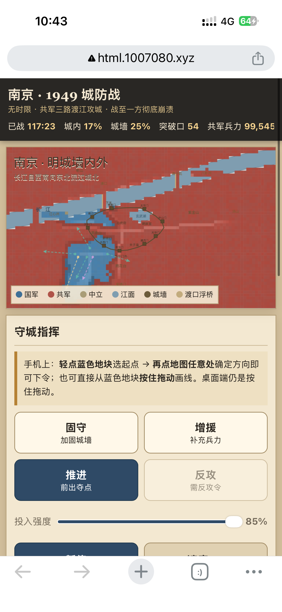

# 死守南京 1949

一个基于原生 HTML、CSS 与 JavaScript 的单文件浏览器策略推演小游戏。玩家扮演守城指挥官，在有限时间内调度城防、增援、推进与反攻，面对从多个方向推进的攻城部队。

> 本项目是面向互动娱乐与历史题材表达的模拟作品，不是对 1949 年南京战事的完整历史复原，也不应替代严肃的历史研究。游戏中的地图、兵力、时间、数值和事件均为玩法设计。



## 项目简介

《死守南京 1949》采用“地图 + 指挥面板 + 战报”的单页界面，重点表现移动端触控下的即时指挥体验。地图使用 Canvas 绘制，所有战局逻辑均在浏览器本地运行，不依赖服务器、数据库或第三方框架。

游戏以一局 2 分 30 秒的速决战为核心节奏。玩家可以选择不同指挥模式，在地图上选定蓝色地块并指定方向，也可以在桌面端通过按住拖动的方式直接下达行动线。南京陷落后，战局会转入残部抵抗阶段；只有当残部被全部歼灭，才会彻底结束。

## 主要玩法

| 系统 | 说明 |
| --- | --- |
| 固守 | 沿行动线提升城墙区域的防御与守备能力。 |
| 增援 | 提升城内兵力，帮助关键区域维持控制。 |
| 推进 | 朝指定方向前出，争夺城门、渡口和外围地块。 |
| 反攻 | 在战局进入后段并获得反攻令后使用，具有更强的突击与压制效果。 |
| 地块情报 | 点击地图地块，查看控制方、兵力、防御与地形。 |
| 战局存取 | 使用浏览器本地存储保存和读取当前战局。 |
| 速度控制 | 加快推演速度，但不会缩短比赛的基础时限。 |
| 响应式界面 | 针对桌面、平板和手机屏幕提供适配布局与触控按钮。 |

## 快速开始

本项目无需安装依赖，直接用现代浏览器打开 `index.html` 即可运行。

如果浏览器限制了本地文件的部分行为，可以在项目目录启动一个静态文件服务器：

```bash
python3 -m http.server 8000
```

然后访问：<http://localhost:8000>

也可以使用任意静态托管服务发布整个目录。项目没有构建步骤，入口文件就是根目录下的 `index.html`。

## 操作说明

在手机上，先轻点蓝色地块作为起点，再点击地图上的任意位置确定方向；也可以直接从蓝色地块按住并拖动来画出行动线。在桌面端，使用鼠标按住蓝色地块拖动即可下令。

右侧或下方的“守城指挥”面板用于选择行动模式、调节投入强度、暂停推演、改变速度和清除指令。“战局”面板展示城内控制比例、城墙状态、突破口、残部据点和共军兵力；“战报”面板记录关键事件，并提供保存、读取与重新开局功能。

## 项目结构

```text
.
├── index.html                  # 游戏主体：结构、样式与玩法逻辑
├── assets/
│   └── promotional-image.png   # 项目宣传图
├── .gitignore
├── LICENSE                     # MIT 开源许可证
└── README.md
```

## 技术实现

项目采用原生 Web 技术实现：HTML 负责界面结构，CSS 负责复古纸张与城防战视觉风格及响应式布局，JavaScript 负责 Canvas 地图绘制、地块状态、兵力流动、指挥输入、战报、胜负判定和本地存档。项目当前不依赖 npm、Webpack、React 或外部 CDN，因此适合直接学习、修改和部署。

## 开发与修改建议

如果你想调整难度，可以在 `index.html` 中查找 `const TUNE`，其中集中定义了攻守双方的推演参数。`LIMIT` 控制基础战局时长，`PHASE2` 控制反攻阶段开启时间，地图几何、城门、渡口、山地和战区数据则位于“地理：南京”部分。

修改后建议至少检查以下场景：在手机宽度下完成一次选点与拖动指令；暂停、继续和改变速度；保存后刷新页面并读取战局；南京陷落后观察残部抵抗阶段；重新开局后确认状态全部重置。

## 版权与开源许可

本项目代码以 MIT License 发布，详见 [`LICENSE`](LICENSE)。宣传图随本仓库一并提供，作为项目展示素材；如果宣传图并非由你独立创作，请在公开发布前确认你拥有相应的转载、修改和再分发权利，或替换为你明确拥有授权的图片。

项目名称、历史题材素材和相关文字可能涉及独立的名称权、著作权或其他权利。开源代码许可不等同于对第三方历史图片、地图、字体、标识或其他素材的授权。贡献者提交内容时，应确保其拥有必要权利，并避免加入未经许可的第三方资源。

## 贡献方式

欢迎通过 Issue 报告问题、提出玩法建议，或通过 Pull Request 改进界面、可访问性、移动端交互和推演平衡。提交代码时请尽量保持“无需构建、无外部依赖”的轻量特征，并在描述中说明修改内容与验证方式。

## 致谢

感谢所有对历史题材互动表达、浏览器小游戏和开源协作感兴趣的贡献者。
